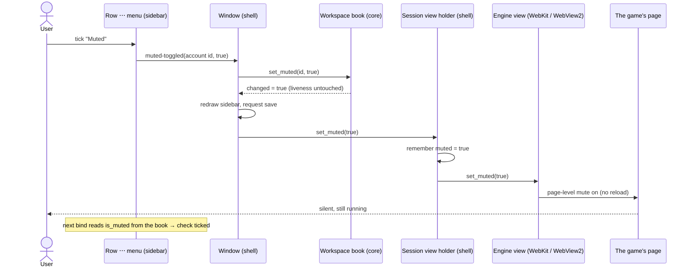
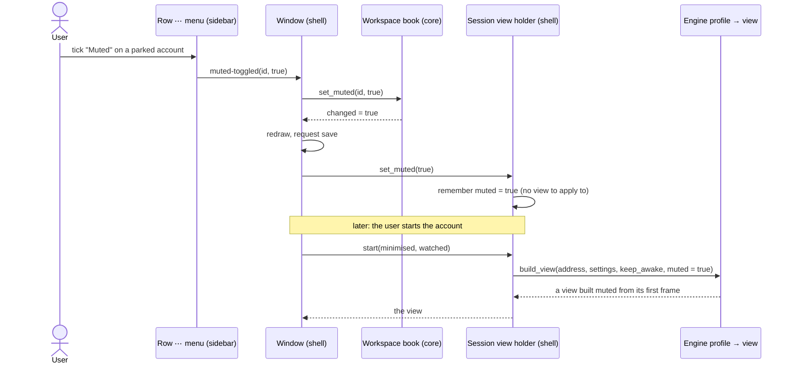

# 17 — Muting one account's sound

**Depends on:** 04, 07, 12 · **Status:** not-started · **Estimate:** 3

## Context

This application keeps several browser idle games running at once in one
window. Each game is an account with its own isolated browser storage, and
each account's page is drawn by the operating system's web engine: WebKitGTK
on Linux, Microsoft Edge WebView2 on Windows. The games run for hours or days
while the owner does other things on the same machine.

Some of those games make noise, and some of them make noise that cannot be
turned off from inside the game. The game's own settings screen has no volume
slider, or has one that the game ignores, or resets it on every reload. Today
the only remedy is the system's mute, which silences the whole computer: every
other game, the music player, the video call. The owner wants to silence one
game and nothing else, and to be able to undo that later with the same ease.

This item adds a per-account mute. Each account carries one more flag, "muted",
alongside the keep-awake flag item 04 gave it. The flag is set and cleared from
the same place every other per-account setting lives: the three-dot menu on the
account's row in the sidebar. The menu gains a check item labelled `Muted`,
sitting beneath `Keep running when hidden` in the settings part of the menu.
Ticking it silences that account; unticking it lets the game sound exactly as
it did before. Nothing inside the game is touched, so a game with a broken
volume control is silenced from outside, by the application, and the game never
knows.

Both web engines already have a switch for this. Each page the engine draws can
be muted as a whole, and the switch covers everything the page plays: ordinary
media elements and the Web Audio graphs modern games synthesise sound with. The
switch flips in place, without reloading the page, so muting costs the game
nothing: no restart, no lost progress, no interval during which the account
reads as starting. That is a deliberate difference from keep-awake, which has
to reload the page to take effect and so moves the account through a starting
state; mute does not, and the row never changes its mark when it is flipped.

The flag has to outlive the page. An account that is parked has no page to
mute, but the owner may still want to tick the box so the game comes back
silent when it is started again. An account that is muted today must still be
muted after the application is closed and reopened tomorrow. So the flag is
part of the account's saved record in the workspace file the application writes
after every change, as one optional key. A file with no muted account is
written exactly as it is today, byte for byte, so nothing changes for anyone
who never uses the feature and an older build of the application can still read
a file written by this one provided no account in it is muted.

The row itself shows no mute symbol. The only readout is the check in the menu,
which is also how keep-awake reads today. Finding out which account is muted
means opening its menu, and that cost is accepted: a mute is set once for a
troublesome game and then left alone, and the row's trailing edge is kept for
the one liveness mark the design rules fix there.

No keyboard shortcut is bound to mute, and the phone remote does not carry the
flag. Both decisions follow from the recorded requirements: the window's letter
chords are spoken for, a once-per-game setting does not earn one, and the phone
page shows a game's picture rather than its settings.

The work is small and runs through every layer the application has. The pure
domain crate gains the flag and the transition that sets it. The storage crate
gains the optional key and maps it to and from the domain. The interface crate
gains the menu item, the handler that carries the choice to the domain and then
to the engine, and the one engine call on each platform that actually silences
the page. On Windows that engine call lives on a newer interface of WebView2
than the one the application already talks to, so the code asks for it and,
when a runtime is too old to answer, logs a warning and leaves the stored flag
as it is rather than refusing the choice; the flag applies the next time a
capable engine builds the page. Where the Windows machine is not available to
exercise the result, that is recorded as a blocker rather than claimed as
working.

## User Experience

- **Entry** — the ⋯ menu on an account's sidebar row, opened by its button,
  a right-click or `Shift`+`F10` (design rule 21). The menu's first section
  holds `Park`/`Start`, `Keep running when hidden`, and now `Muted`.
- **Flow** — Mute a live account: open its row menu, tick `Muted` → the menu
  closes, the game goes silent at once, the page keeps running, the row's dot
  and name do not change. Open the menu again → `Muted` is ticked.
- **Flow** — Unmute: open the row menu, untick `Muted` → the game sounds again
  exactly as before, with no reload.
- **Flow** — Mute a parked, queued or starting account: tick `Muted` → the
  check is stored and shows ticked; the account's page is built muted the
  moment it starts, and stays muted until unticked.
- **Flow** — Park a muted account and start it again → it comes back muted.
  Quit the application and reopen it → every muted account is still muted,
  and every other account still sounds.
- **States** — Ticking `Muted` on an account that is already muted, or
  unticking an unmuted one, changes nothing: the domain reports no change and
  nothing is saved or applied.
- **States** — The engine refuses the mute call (a WebView2 runtime older than
  1.0.864): the check still reads as stored, the page is not silenced, and one
  warning naming the account and the runtime version goes to the log. No
  message strip.
- **States** — Toggling mute never shows the reloading mark, never moves the
  account to `Starting`, and never disturbs a phone watching the account.
- **Pattern** — a stateful check item in the row's ⋯ menu whose handler reports
  the intent and never sets its own state; the row redraws from the domain's
  answer. This is design rule 5's settings section and the keep-awake path at
  `crates/idle-manager-shell/src/session_sidebar/imp.rs:932`.
- **Pattern** — no mark on the row for the flag. Design rule 1 fixes the one
  leading liveness mark, and design rule 6 records the keep-awake mark being
  dropped from the trailing edge on 2026-09-22 for the same reason.
- **Pattern** — the menu item carries no accelerator, so design rule 27's
  "show the chord only where it does something" has nothing to show.

### Muting a live account from its row menu

The screen is the main window with the sidebar open. The components are the
row's `gtk::MenuButton` and its `gio::Menu`, the stateful `muted` action in
the row's action group, the window's handler, the workspace book, the account's
session view holder and the engine view it currently holds. The user ticks the
item; the handler sends the account id and the requested value and nothing
else. The book records the flag and reports whether it changed. On a change the
window redraws the sidebar (so the next menu bind shows the check ticked),
schedules a save of the workspace file, and tells the holder, which remembers
the flag and flips the engine's page-level mute on the live view. The row's
mark, the account's liveness and the page's content are all untouched.

### Muting an account with no page, and starting it later

Same screen, same components, but the account is parked, queued or starting
and so holds no engine view. The holder stores the flag and returns nothing to
apply. When the account is later started, the holder builds the view with the
remembered flag, so the game's first sound is already muted. The same path
covers a relaunch: the workspace file carries the flag, the book is restored
from it, and the holder is created with the flag before any view exists.

## Technical Details

### Back-end

Back-end here is `idle-manager-core` and `idle-manager-store`, in that order,
and both obey `docs/architecture.md` rules 1, 7 and 8 and `docs/naming.md`
rule 12.

In `idle-manager-core`, add a private `is_muted: bool` field to `Session` in
`session.rs`, a public `is_muted()` reader beside `is_kept_awake()`, and a
`SessionBook::set_muted(&mut self, session: &SessionId, value: bool) -> bool`
transition beside `set_keep_awake`. Unlike `set_keep_awake`, it never changes
liveness: the shell applies a mute in place with no reload, so there is no
"no page has painted yet" interval to represent. It returns `false` for an
unknown id and for a value already held, `true` otherwise. Add
`WorkspaceBook::set_muted` in `workspace_book.rs` beside `set_keep_awake`,
delegating to the holding book. Add `pub is_muted: bool` to `Account` in
`workspace.rs`, map it in both directions in the `Session`-from-`Account` and
`Account`-from-`Session` conversions in `session.rs`, and default it to `false`
wherever a `Session` or `Account` is built today (`SessionBook::add`, the
preset path, the tests' fixtures). `RemoteAccount` in `remote.rs` is not
changed. Unit tests at the foot of `session.rs` per `docs/code-standards.md`
rules 21 to 24 pin: a new account starts unmuted; setting the current value
reports no change; muting a live account leaves it `Live`; muting a parked
account leaves it `Parked`; the flag survives park, unpark, a layout change and
a move between workspaces; an unknown id reports no change; a round trip through
`workspace()` and `restore()` preserves it.

In `idle-manager-store`, add `muted: bool` to `SessionEntry` in
`session_file.rs` with `#[serde(default, skip_serializing_if = "std::ops::Not::not")]`,
so the key is read when present, `false` when absent, and omitted on write when
`false`. `FORMAT_VERSION` stays 3, and `LegacySessionEntry` is not changed: no
version 1 or 2 file ever carried the key. Map `entry.muted` to
`Account::is_muted` in `entry_to_account` and back in `account_to_entry`. The
existing snapshot test for the workspace file must pass unchanged, which is the
byte-identical guarantee. Add integration tests in
`tests/the-workspace-file-on-disk.rs`: a muted account round-trips; an unmuted
account's entry has no `muted` key; a file with `muted = true` on one entry
reads back with only that account muted.

### Front-end

Front-end is `idle-manager-shell`, obeying `docs/architecture.md` rules 8, 10
and 12 and `docs/design.md` rules 5, 6 and 21. Nothing names an engine type
outside `web_engine/` (architecture doc, "Where a change goes").

**Engine seam.** In `web_engine/webkit.rs`, add a `muted: bool` parameter to
`EngineProfile::build_view` and pass it to the builder as `.is_muted(muted)`;
add `EngineView::set_muted(&self, on: bool, id: &SessionId)` calling
`self.view.set_is_muted(on)` and logging at `debug` with the session field. In
`web_engine/webview2.rs`, add the same `muted` parameter, carry it as a new
`muted: bool` field on `PendingView` in `webview2/host.rs`, and add
`EngineView::set_muted` delegating to a new `EngineHost::set_muted(on)`. In
`webview2/host/imp.rs`, `set_muted` applies to the live view when one exists
and otherwise writes the value onto the pending view, so a toggle between
construction and realisation is not lost (which is better than `set_zoom`'s
no-op, and is the reason the pending value is mutable). The post-creation path
that today applies the zoom and disables the zoom control also applies
`pending.muted` when it is `true`. The actual call is a new
`ffi::set_muted(webview: &ICoreWebView2, muted: bool) -> windows::core::Result<()>`
in `webview2/ffi.rs` that casts to `ICoreWebView2_8` and calls `put_IsMuted`,
following the `delete_profile` cast pattern at `ffi.rs:233`. A failed cast or
call is logged once at `warn` with the session and `wry::webview_version()`,
and nothing else happens (code-standards rules 14 and 15).

**Holder.** In `web_view.rs`, `SessionView` gains a `muted: bool` field beside
`keep_awake`. `SessionView::dormant` and `SessionView::new` take `muted: bool`
and store it, so a holder built for a restored account carries the flag before
any view exists. `start` passes `self.muted` to `build_view`.
`SessionView::set_muted(&mut self, on: bool) -> Option<&EngineView>` remembers
`on`, applies it to the live view through `EngineView::set_muted` if there is
one, and returns that view or `None`. It takes no `minimised` argument and
never touches `set_background`: mute has nothing to do with visibility.

**Sidebar.** In `session_sidebar/row/imp.rs`, add an `is_muted: Cell<bool>`
property mirrored from `Session::is_muted`, set in `Row::new` in `row.rs`
beside `is-kept-awake`. In `session_sidebar/imp.rs`, add
`const MUTED_ACTION: &str = "muted"`, build a `gio::SimpleAction::new_stateful`
for it in `build_row_action_group` whose `change-state` handler reports
`(id, requested)` through a new `on_muted_toggled` callback cell and never calls
`set_state` itself (architecture rule 8, the keep-awake pattern at
`imp.rs:932`). In `build_row_menu_model`, append `Muted` to `actions_section`
immediately after `Keep running when hidden`, with no accelerator. Expose
`SessionSidebar::connect_muted_toggled` in `session_sidebar.rs` beside
`connect_keep_awake_toggled`.

**Window.** In `window/imp.rs`, connect `connect_muted_toggled` where the
keep-awake one is connected, to a new `toggle_muted(&self, id, value)`: call
`book.set_muted`; return if nothing changed; `redraw()`; `request_save()`;
then `holders.get_mut(id).set_muted(value)`. No `connect_painted`, no
`finish_starting`, because liveness did not move. At the three holder creation
sites (the restore loop, the single dormant add, and the new-account path),
read `is_muted` off the session and pass it to `dormant` / `new`.

**Shortcuts window and phone.** Unchanged: no key is bound (FR.28.6), and
`RemoteAccount` carries no flag.

### Technical References

- WebKitGTK `WebKitWebView:is-muted` is a read-write property since 2.30; the
  `webkit6` 0.6.1 crate exposes it as `WebViewExt::set_is_muted` and a builder
  setter. Muting at the view level silences media elements and Web Audio alike.
- WebView2 `ICoreWebView2_8::put_IsMuted` (runtime 1.0.864.35, SDK 1.0.864.35,
  June 2021) mutes all audio output of the page without reloading. The
  `webview2-com-sys` 0.39.1 crate carries the interface; the live
  `ICoreWebView2` is reached through `wry::WebViewExtWindows::webview`, and the
  cast is `webview.cast::<ICoreWebView2_8>()`.

## Blockers

- A restored account's holder is built with keep-awake off regardless of the
  saved flag: the restore loop at `crates/idle-manager-shell/src/window/imp.rs:1167`
  calls `SessionView::dormant`, which sets `keep_awake: false`, and nothing
  later copies `Session::is_kept_awake` onto the holder. Mute must not repeat
  this, which is why `dormant` takes the flag. Whether to fix keep-awake the
  same way is a separate decision, not this item's.
- The Windows path (`webview2/ffi.rs`, `webview2/host/imp.rs`) cannot be run on
  this machine: `make windows-check` compiles and lints only, and `docs/ditched/01`
  records that nobody on the project has a Windows machine. FR.28.7 says this is
  recorded, not claimed.
