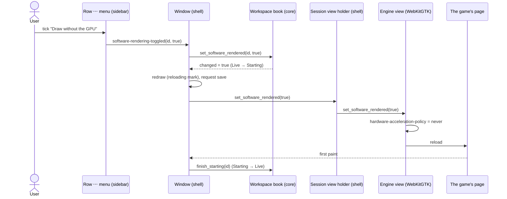
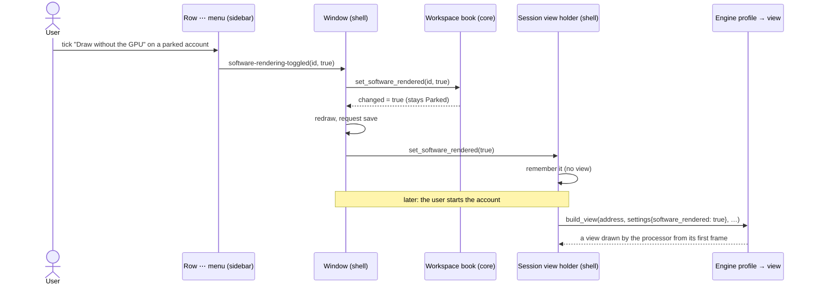

# 18 — Drawing one account without the GPU

**Depends on:** 04, 06, 07, 17 · **Status:** in-progress · **Estimate:** 3

## Context

This application keeps several browser idle games running at once in one
window. Each game is an account with its own isolated browser storage, and each
account's page is drawn by the operating system's web engine: WebKitGTK on
Linux, Microsoft Edge WebView2 on Windows. The owner leaves the games running
for hours on a Linux laptop with an Intel Arc graphics chip, which shares the
computer's ordinary memory instead of having memory of its own.

On 2026-10-24 one game, Lux Idle, took that laptop down twice. Opening the
game's list of hunting grounds made memory climb so fast that the window froze,
then the desktop froze, and the kernel began killing unrelated programs to
free memory, until the machine had to be restarted. The same click in
Microsoft Edge on the same laptop was fine.

The investigation measured why. The memory did not go into any program's
ordinary memory, which is why the application's own memory footer showed
nothing unusual. It went into graphics buffers that the web engine asks the
graphics driver for when it draws a page with the graphics chip. After the
click, the account's rendering process asked for about one gigabyte of
graphics buffers every tenth of a second; the kernel's own report at the first
crash counted 27 GB of them. The trigger is a single rule in the game's style
sheet: hunting grounds the character is too low a level for are drawn greyed
out and darkened with a visual filter, and a level 8 character sees about
eighty of the ninety cards that way. Removing just that rule from the page
removes the problem. Running the same game in a bare WebKitGTK window that
shares none of this application's code reproduces it exactly, so the fault
sits in the web engine's graphics path on this hardware, not in anything the
application adds. Edge uses a different engine, which is why it was fine.

The application cannot fix the engine. What it can do is choose how the
engine draws each account. The engine has a per-page switch that turns off
graphics-chip drawing for that page alone: the page is then painted and
assembled by the processor, and asks for no graphics buffers at all. With the
switch on, the same click on the same hunting list stayed flat. For this game
it is also cheaper in memory overall: the account dropped from about 850 MB of
graphics buffers to almost none, for about a seventh of one processor core more
work. For other games the trade may go the other way, which is why the switch
must be per account and off by default.

This item adds that switch. Each account carries one more flag, "draw without
the GPU", alongside the keep-awake and mute flags earlier items gave it. It is
set and cleared from the three-dot menu on the account's row in the sidebar,
where those two already live. Because the engine decides how a page is drawn
when the page is built, flipping it on a running account reloads that
account's page once, the same way changing keep-awake does. The flag is saved
in the workspace file the application writes after every change, as one
optional key that is left out when it is off, so nothing changes on disk for
anyone who never uses it. A game's preset file can also ask for the flag, so
that an account added from that preset starts with it on; the repository gains
a Lux Idle preset that does.

On Windows the switch has nothing to act on. WebView2 is the same engine as
Edge, the fault was never seen there, and its only way to stop using the
graphics chip applies to every account at once. So the flag is kept in the
workspace file on Windows but the menu item is only shown in the Linux build.

The finding itself, with its measurements, is recorded in this item so the
switch is never mistaken for a fix of the application's own code, and so the
engine fault can be reported to the WebKitGTK project.

## User Experience

- **Entry** — the ⋯ menu on an account's sidebar row, opened by its button, a
  right-click or `Shift`+`F10` (design rule 21). The menu's first section holds
  `Park`/`Start`, `Keep running when hidden`, `Muted`, and now
  `Draw without the GPU` (Linux build only).
- **Flow** — Turn it on for a live account: open its row menu, tick
  `Draw without the GPU` → the menu closes, the row shows the reloading mark,
  the page reloads once and comes back drawn by the processor; the row returns
  to its live mark at the first paint.
- **Flow** — Turn it off: untick it → the same single reload, back to GPU
  drawing.
- **Flow** — Tick it on a parked, queued or starting account → the check is
  stored and shows ticked; the page is built without the GPU when it starts.
- **Flow** — Park and start it, or quit and reopen the application → the
  account still draws without the GPU; every other account is unchanged.
- **Flow** — Add an account from a preset whose file says
  `software_rendering = true` (the shipped `lux-idle.toml`) → it starts with
  the item ticked.
- **States** — Ticking an item that is already ticked, or the reverse, changes
  nothing: the domain reports no change, nothing reloads, nothing is saved.
- **States** — A preset file whose `software_rendering` value is not `true` or
  `false` loads with the flag off and one warning naming the file, the same
  tolerance the `webgl` key has.
- **States** — Turning it on for a running account stops the runaway at the
  reload, but the page's rendering process keeps the GPU objects it already
  held (measured 847 → 418 MiB, then flat); a view built with the flag — after
  park and start, or a relaunch — holds about 14 MiB.
- **States** — Windows: no menu item; a `software_rendering = true` key written
  on Linux survives a save on Windows untouched and is ignored by WebView2.
- **Pattern** — a stateful check item in the row's ⋯ menu whose handler reports
  the intent and never sets its own state (design rule 5; the keep-awake path
  at `crates/idle-manager-shell/src/session_sidebar/imp.rs:932`).
- **Pattern** — a setting that needs a reload moves a live account through
  `Starting` to `Live` with the reloading mark, exactly as keep-awake does
  (design rule 1; `toggle_keep_awake` at
  `crates/idle-manager-shell/src/window/imp.rs:2311`).
- **Pattern** — no mark on the row for the flag and no accelerator, as for
  mute (design rules 1, 6 and 27).

### Turning GPU drawing off for a live account

The screen is the main window with the sidebar open. The components are the
row's menu button and menu model, the stateful `software-rendering` action in
the row's action group, the window's handler, the workspace book, the account's
view holder and its engine view. The handler sends the id and the requested
value. The book records the flag and, for a live account, moves it to
`Starting`, so the redraw shows the reloading mark. The window saves, tells the
holder, and the holder sets the engine policy on the live view and reloads it.
The painted signal at the first frame ends the starting interval.

### Turning it on for an account with no page

Same screen and components; the account holds no engine view. The holder
stores the flag in the account's view settings, and the next view is built
with the policy already set, so the page never touches the GPU path. A
relaunch takes the same route: the workspace file carries the flag, the book
is restored from it, and every holder is created with it.

## Technical Details

### Back-end

Back-end is `idle-manager-core` and `idle-manager-store`, obeying
`docs/architecture.md` rules 1, 7 and 8, `docs/naming.md` rule 12 and
`docs/code-standards.md` rules 18 and 21 to 24.

In `idle-manager-core`, add a private `is_software_rendered: bool` field to
`Session` in `session.rs`, a public `is_software_rendered()` reader beside
`is_muted()`, and `SessionBook::set_software_rendered(&mut self, session:
&SessionId, value: bool) -> bool` beside `set_keep_awake`. Like
`set_keep_awake` and unlike `set_muted`, a change on a `Live` account moves it
to `Starting` (the view is rebuilt by a reload), and a change on any other
liveness leaves liveness alone; it returns `false` for an unknown id or a value
already held. Add `WorkspaceBook::set_software_rendered` in
`workspace_book.rs` delegating to the holding book. Add
`pub is_software_rendered: bool` to `Account` in `workspace.rs` and map it in
both conversions in `session.rs`. Add `pub is_software_rendered: bool` to
`Preset` in `preset.rs` and copy it in `SessionBook::add_from_preset`;
`SessionBook::add` (typed address) sets `false`. Fixtures that build `Session`,
`Account` or `Preset` gain the field as `false`. `RemoteAccount` is not
changed. Unit tests in `session.rs`: a new account is not software rendered;
an account from a preset with the flag starts with it; setting the held value
reports no change; setting it on a live account moves it to `Starting`; on a
parked account it stays `Parked`; it survives park, unpark, a layout move, a
workspace move and a `workspace()` → `restore()` round trip; an unknown id
reports no change.

In `idle-manager-store`, add `software_rendering: bool` to `SessionEntry` in
`session_file.rs` with `#[serde(default, skip_serializing_if =
"std::ops::Not::not")]`; `FORMAT_VERSION` stays 3 and `LegacySessionEntry` is
untouched. Map it in `entry_to_account` and `account_to_entry`. The existing
workspace snapshot test must pass unchanged. Integration tests in
`tests/the-workspace-file-on-disk.rs`: the flag round-trips; an entry without
it has no key; a file with the key on one entry reads back with only that
account flagged. In `preset.rs`, add `software_rendering: Option<toml::Value>`
to `PresetFile` and a `software_rendered(value, entry) -> bool` reader that
mirrors `webgl_enabled` (absent or non-boolean → `false`, the latter with one
`warn` naming the file), with a `SOFTWARE_RENDERING_DEFAULT: bool = false`
constant. Add `presets/lux-idle.toml` (`name = "Lux Idle"`,
`url = "https://luxidle.com.br/jogar"`, `zoom = 1.0`, `keep_awake = false`,
`software_rendering = true`, its comment naming this item and the measurement)
and append it to `SHIPPED_PRESETS`. Unit tests beside the `webgl` ones, and a
`tests/reading-the-game-files.rs` case that the shipped Lux Idle file reads
back with the flag on and the other three with it off.

### Front-end

Front-end is `idle-manager-shell`, obeying `docs/architecture.md` rules 8, 10
and 12 and `docs/design.md` rules 1, 5, 6, 21 and 27. No engine type leaves
`web_engine/`.

**Engine seam.** Add `pub is_software_rendered: bool` to `AccountSettings` in
`web_view.rs`. In `web_engine/webkit.rs`, `apply_account_settings` sets
`settings.set_hardware_acceleration_policy(HardwareAccelerationPolicy::Never)`
when the flag is on and leaves the policy untouched otherwise, with a comment
recording the 2026-10-24 measurement (code-standards rule 18). Add
`EngineView::set_software_rendered(&self, on: bool, id: &SessionId)` that sets
the policy to `Never`, or back to the engine's own default — read from a
fresh `webkit6::Settings::new()`, never hard-coded, so an engine that changes
its default is followed (code-standards rule 18) — and reloads.
In `web_engine/webview2.rs`, `EngineView::set_software_rendered` is a `debug`
log and nothing else, and the build path ignores the field, with a comment
stating why (FR.29.6).

**Holder.** `SessionView::set_software_rendered(&mut self, on: bool) ->
Option<&EngineView>` in `web_view.rs` writes `self.settings.is_software_rendered`
and, with a live view, calls `EngineView::set_software_rendered`; it returns
the view or `None`. `start` already passes `self.settings` to `build_view`.

**Sidebar.** In `session_sidebar/row/imp.rs` add an
`is-software-rendered` property mirrored from the session in `Row::new`. In
`session_sidebar/imp.rs`, add `const SOFTWARE_RENDERING_ACTION: &str =
"software-rendering"`, a stateful action in `build_row_action_group` whose
`change-state` handler reports `(id, requested)` through an
`on_software_rendering_toggled` callback and never sets its own state, and in
`build_row_menu_model` append `Draw without the GPU` after `Muted`, under
`#[cfg(target_os = "linux")]`. Expose
`SessionSidebar::connect_software_rendering_toggled`.

**Window.** In `window/imp.rs`, connect it to a new
`toggle_software_rendered(&self, id, value)` that follows `toggle_keep_awake`
line for line: book set, return on no change, redraw, request save, holder
set, and on a live view arm `connect_painted` → `finish_starting`. At the three
`AccountSettings` construction sites read `session.is_software_rendered()`
into the new field.

**Docs.** `docs/memory-budget.md` gains a paragraph that GPU buffers are
invisible to the PSS footer, citing this item's measurement.

### Technical References

- `WebKitSettings:hardware-acceleration-policy` (`webkit6` 0.6.1
  `Settings::set_hardware_acceleration_policy`) is per view. `Never` paints and
  composites on the CPU; measured on this laptop it held the web process at
  14 MiB of GPU objects with the hunt list open.
- Engine-wide alternatives measured and rejected for an app-wide default:
  `WEBKIT_DISABLE_DMABUF_RENDERER=1` (flat, but every account), and
  `WEBKIT_SKIA_ENABLE_CPU_RENDERING=1` (no GPU growth, but a bounded 2.5 GiB
  PSS burst in the one process).
- Per-process GPU memory on the `xe` driver is readable from
  `/proc/<pid>/fdinfo/<fd>` (`drm-total-*` keys, deduplicated by
  `drm-client-id`); cgroups do not charge it (`memory.stat` has no GPU key on
  kernel 7.0), so `MemoryMax` cannot contain it.
- The 2026-10-24 bisect (release build, same profile copy, a probe that picks
  the character and clicks `GO HUNT` at ~34 s, kill at +400 MiB):

  | Run | One change | Web-process GPU after the click |
  | --- | --- | --- |
  | r04, r05, r08 | none (as shipped) | 0.9 → 1.6 → 4.2 → 5.8 GiB in 0.4 s |
  | r06 | 2D-canvas acceleration off | spike |
  | r11 | WebGL off | spike |
  | r23 | `WEBKIT_SKIA_GPU_PAINTING_THREADS=0` | spike |
  | r07 | bare WebKitGTK window, none of the app's code | spike (+2.1 GiB in 0.2 s) |
  | r09 | `WEBKIT_SKIA_ENABLE_CPU_RENDERING=1` | flat GPU; PSS 565 → 2512 → ~1000 MiB |
  | r10 | `WEBKIT_DISABLE_DMABUF_RENDERER=1` | flat (16 MiB) |
  | r13 | `hardware-acceleration-policy = never` | flat (14 MiB); PSS 650 → 970 MiB |
  | r14 | page CSS: every `filter` removed (diagnostic) | flat |
  | r19 | page CSS: only `.hunt-card.locked` filter removed (diagnostic) | flat |

  Town, no click, per account: as shipped 0.84 web + 0.08 shell cores and
  ~850 MiB GPU; policy `never` 0.97 + 0.12 cores and 14 MiB GPU.

## Blockers

- The engine fault is not fixed by this item, only avoided per account. It
  needs an upstream report to WebKitGTK (2.52.6, Mesa 26.0.8, `xe`, Lunar Lake)
  with the synthetic page that reproduces the filter cost; the minimal page
  measured +457 MiB for 84 filtered cards but not the runaway, so the report
  needs the runaway reduced further; the page that shows the cost is
  `docs/roadmap/18-drawing-without-the-gpu/filtered-cards-repro.html`. Not
  filed yet.
- GPU memory freed by a killed rendering process came back to the system only
  slowly (15.6 GiB unaccounted fell to 8 GiB over about 20 minutes after the
  crash); whether the `xe` driver leaks it is outside the application and is
  noted, not chased.
- `presets/` is only seeded into the user's preset folder when that folder is
  missing (`SHIPPED_PRESETS` in `crates/idle-manager-store/src/preset.rs`), so
  the owner's existing folder will not receive `lux-idle.toml`; their two
  existing Lux Idle accounts are typed-address accounts and are switched from
  the row menu instead.
- The memory footer (`crates/idle-manager-shell/src/memory_footer.rs`) reads
  PSS only and cannot show GPU buffers; showing them is a separate item.
